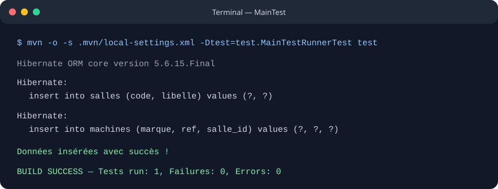
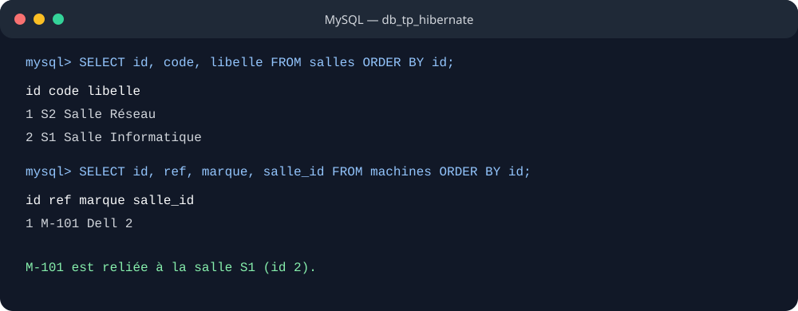

# Lab 4 — Hibernate et persistance

Exemple Java avec Hibernate 5, MySQL et une architecture DAO / Service pour les entités `Salle` et `Machine`.

Avant l'exécution, créer la base MySQL configurée dans `src/main/resources/hibernate.cfg.xml` :

```sql
CREATE DATABASE db_tp_hibernate;
```

Hibernate crée ensuite les tables au démarrage (`hbm2ddl.auto=update`). Lancer les tests avec `mvn test` après avoir configuré la connexion MySQL.

## Exécution de l'exemple

Le rendu ci-dessous reprend la sortie de l'exécution réussie de `MainTest` via Maven.



`MainTest` a inséré la salle S1 et la machine M-101 (Dell) dans MySQL.

## Données MySQL

Résultat d'une vérification SQL effectuée après l'exécution de l'exemple.



La table `machines` contient M-101, liée à la salle S1 par `salle_id`.
