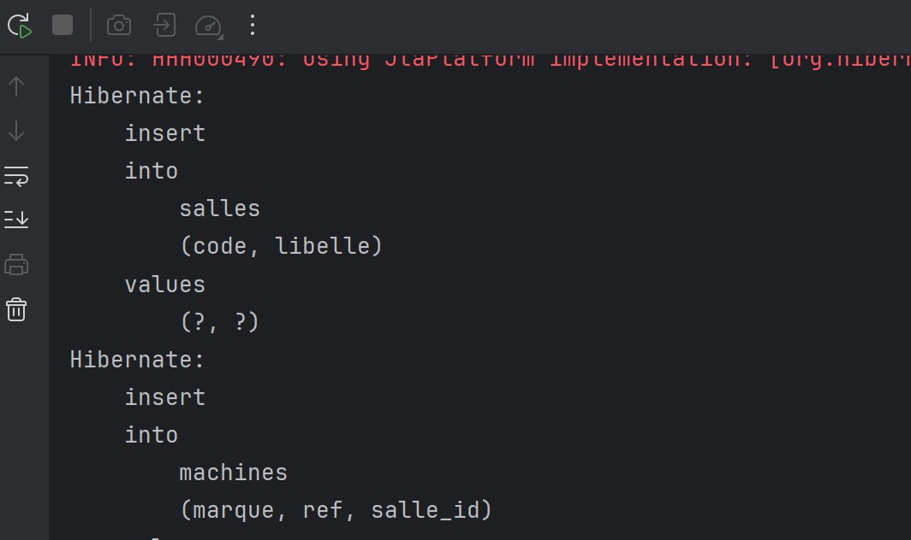
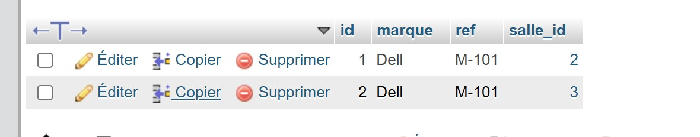

# Lab 4 — Hibernate et persistance

Exemple Java avec Hibernate 5, MySQL et une architecture DAO / Service pour les entités `Salle` et `Machine`.

Avant l'exécution, créer la base MySQL configurée dans `src/main/resources/hibernate.cfg.xml` :

```sql
CREATE DATABASE db_tp_hibernate;
```

Hibernate crée ensuite les tables au démarrage (`hbm2ddl.auto=update`). Lancer les tests avec `mvn test` après avoir configuré la connexion MySQL.

## Captures d'exécution

La console montre les requêtes d'insertion exécutées par Hibernate.



Cette vue phpMyAdmin montre les machines Dell enregistrées et leurs identifiants de salle.


Cette seconde vue affiche les lignes de la table `machines` sans infobulle superposée.


